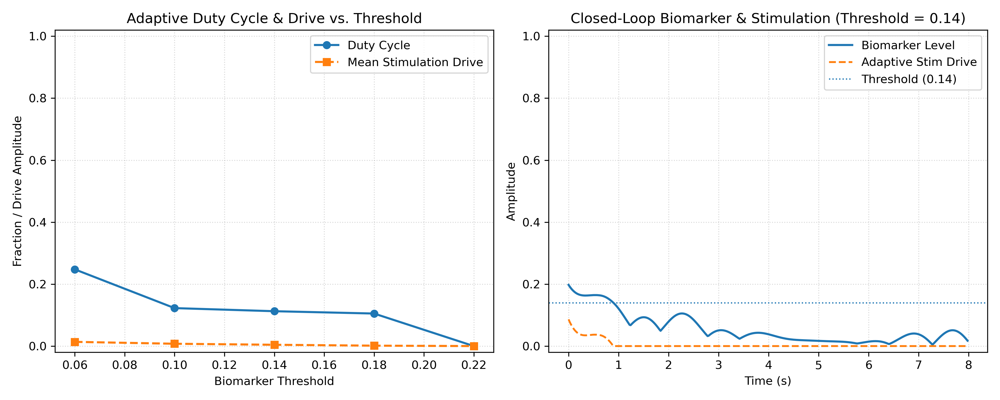

# Biomarker-Driven Adaptive Stimulation (`neurotwin-03-biomarker-adaptive-stimulation`)

Evaluate closed-loop proportional stimulation triggered by a network biomarker threshold across a coupled 12-unit neural ensemble under periodic perturbation bursts in **C++17**.



## Scientific Motivation & Overview

Closed-loop neurostimulation aims to deliver therapeutic drive selectively when a target physiological or pathological biomarker crosses an elevated threshold, balancing symptom/biomarker suppression against stimulation duty cycle and energy expenditure.

This project implements:

1. A coupled 12-unit ring simulator in C++17 (`src/adaptive_stimulation.cpp`) subjected to time-varying oscillatory perturbation bursts and restorative feedback toward a target state (`0.45`).
2. A threshold-gated proportional controller that computes a composite biomarker (`|mean_state - target| + 1.8 * std(state)`) and applies stimulation drive only when `Biomarker_Level > Threshold`.
3. A sanity verification gate (`tests/verify_gate.py`) and a threshold sweep (`scripts/run_threshold_sweep.py`) across `Threshold` values from `0.06` to `0.22`.

## Repository Structure

- `src/adaptive_stimulation.cpp`: C++17 closed-loop ensemble simulator, adaptive threshold controller, and trajectory CSV exporter.
- `scripts/run_threshold_sweep.py`: Compiles `src/adaptive_stimulation.cpp`, sweeps `Threshold` across `[0.06, 0.10, 0.14, 0.18, 0.22]`, saves `results/threshold_sweep.csv` and `results/trajectory_thresh0.14.csv`, and generates `figures/main_result.png`.
- `tests/verify_gate.py`: Verification gate confirming C++17 compilation, 300-step trajectory CSV generation, `[0, 1]` bounds on continuous variables, and binary `Active` flags.
- `results/`: Generated sweep and trajectory CSV outputs (`threshold_sweep.csv`, `trajectory_thresh0.14.csv`).
- `figures/main_result.png`: Two-panel summary figure showing duty cycle and mean stimulation drive vs. threshold, plus time-series biomarker and stimulation waveforms at `Threshold = 0.14`.
- `data/.gitkeep`: Placeholder directory for external or benchmark datasets.

## Sweep Results (`stim_gain = 1.50`, 400 steps, `dt = 0.02`)

| Threshold | Mean Biomarker | Duty Cycle | Mean Stim |
| :--- | :--- | :--- | :--- |
| `0.06` | `0.0417` | `0.2475` | `0.0136` |
| `0.10` | `0.0486` | `0.1225` | `0.0075` |
| `0.14` | `0.0561` | `0.1125` | `0.0042` |
| `0.18` | `0.0651` | `0.1050` | `0.0013` |
| `0.22` | `0.0696` | `0.0000` | `0.0000` |

## Key Findings & Conclusions

- **Threshold controls the biomarker-vs.-stimulation trade-off:** Lowering `Threshold` from `0.22` to `0.06` reduces `Mean_Biomarker` from `0.0696` to `0.0417` while increasing `Duty_Cycle` from `0.0000` to `0.2475` and `Mean_Stim` from `0.0000` to `0.0136`.
- **Sparsity at higher thresholds:** At `Threshold = 0.22`, biomarker excursions under this burst profile never cross the threshold (`Duty_Cycle = 0.0000`, `Mean_Stim = 0.0000`), establishing an upper bound where no stimulation is triggered.
- **Intermediate operating point:** `Threshold = 0.14` keeps stimulation active on `11.25%` of steps (`Mean_Stim = 0.0042`) while holding `Mean_Biomarker` at `0.0561`.

## Next Steps for Future Researchers & Collaborators

1. **Control law comparisons:** Benchmark proportional threshold control against PID, hysteresis/dead-band, or model-predictive/reinforcement-learning controllers under identical perturbation bursts.
2. **Gain, latency, and refractory constraints:** Sweep `stim_gain`, sensing/actuation delays, and minimum inter-burst refractory windows to evaluate stability and energy efficiency.
3. **Spectral and phase-specific biomarkers:** Replace the state-deviation/spread biomarker with band-specific power, phase-amplitude coupling, or coherence estimates from multi-channel neural recordings.
4. **Hardware-in-the-loop & twin co-simulation:** Couple this C++17 controller directly with calibrated subject twins from earlier sprint modules to test patient-specific threshold selection.

## How to Run Locally

```bash
python3 tests/verify_gate.py
python3 scripts/run_threshold_sweep.py
```
